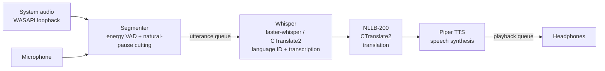

# 🌎 Real-Time Voice Translator

**Hear any meeting or video translated into your language, in your headphones, in under a second — running 100% locally.**

A Windows desktop prototype that captures system audio (Zoom, Teams, Google Meet, YouTube…) or a microphone, detects the spoken language automatically, translates it, and speaks the translation in your headphones. Speech recognition, translation and speech synthesis all run on your own machine: **the audio never leaves your computer**.

> 🇧🇷 *Resumo em português no final da página.*

---

## ✨ Highlights

- **~0.2–0.6 s end-to-end latency** on a consumer NVIDIA GPU (measured, see below)
- **Automatic language detection** — ~100 input languages (Whisper), no need to pick the source language
- **System audio capture** via Windows WASAPI loopback — works with any meeting app or video, no virtual cables
- **Fully local pipeline** — no API keys, no cloud, no per-minute costs
- **Hardware-aware** — uses the GPU when an NVIDIA card is available, falls back to a lighter CPU profile otherwise
- **Concurrent pipeline** — listening never stops while a translation is playing
- **Graceful degradation** — every local component falls back to an online alternative if it fails

## 🏗️ Architecture



Each stage runs in its own thread connected by queues, so capture, transcription/translation and playback overlap instead of blocking each other.

| Stage | Library | Notes |
|---|---|---|
| Capture | `soundcard` (WASAPI loopback), `sounddevice` | Choose which output device to capture and where to play the translation |
| Segmentation | NumPy | Energy-based VAD; long speech is split at the quietest micro-pause, not mid-word |
| Speech-to-text | `faster-whisper` | GPU float16 or CPU int8; previous sentence passed as context |
| Translation | NLLB-200 600M via `ctranslate2` + `sentencepiece` | Sentence-level batching; Japanese/Chinese split on whitespace |
| Text-to-speech | `piper-tts` | ~0.1 s per sentence on CPU; speeds up automatically when a backlog builds |

## 📊 Measured latency

Time from the **end of a spoken sentence** to the **start of the translated audio** (Windows, NVIDIA GPU, Whisper `small`):

| Version | Speech-to-text | Translation | Voice | **Total** |
|---|---|---|---|---|
| v1 — CPU + online services | ~2 s | 0.4–4 s | 1–2 s | **~3–4 s** |
| v7 — fully local, GPU | 0.1–0.4 s | 0.0–0.1 s | 0.0–0.1 s | **~0.2–0.6 s** |

## 🧠 Engineering problems solved

- **Echo loop** — when capture and playback share a device, the translator would hear its own voice. Capture is gated while translated speech plays; routing them to different devices removes the trade-off entirely.
- **Whisper hallucinations** — on music or silence Whisper invents phrases like *"Thanks for watching!"*. A phrase filter plus a language-confidence threshold drops them.
- **Short utterances** — one-word interjections get low language confidence. When in doubt, the transcriber re-decodes using the language of the ongoing conversation.
- **Context loss in long speech** — instead of a hard cut at N seconds, the segmenter cuts at the quietest point in the last 3 s and carries the remainder forward.
- **Backlog** — continuous speech can outpace playback; speech rate increases automatically when translations queue up.
- **Windows quirks** — loopback delivers no frames during silence (handled with queue timeouts); eSpeak fails on non-ASCII paths (data copied to an ASCII-only folder and validated in a subprocess so a native crash can't take down the app); CUDA DLLs loaded from pip-installed NVIDIA wheels, no CUDA toolkit install needed.
- **European vs. Brazilian Portuguese** — NLLB outputs mostly European Portuguese; a rule-based post-processor converts common constructions (*"lembro-me" → "me lembro"*, *"está a fazer" → "está fazendo"*, *"telemóvel" → "celular"*).

## 🚀 Getting started

**Requirements:** Windows 10/11, Python 3.11 or 3.12. An NVIDIA GPU is optional but recommended.

```powershell
git clone https://github.com/Ferpajr/realtime-voice-translator.git
cd realtime-voice-translator
python -m venv venv
Set-ExecutionPolicy -Scope Process -ExecutionPolicy Bypass
.\venv\Scripts\Activate.ps1
pip install -r requirements.txt

# Optional, NVIDIA GPU only (~1 GB, no CUDA toolkit needed):
pip install -r requirements-gpu.txt

python tradutor.py
```

On first run the app downloads the models automatically (Whisper, the NLLB translator ~1.2 GB and the Piper voice ~60 MB).

### Recommended setup for meetings

1. In Windows **Settings → System → Sound → Volume mixer**, send your meeting app or browser to a secondary output (e.g. your monitor's speakers).
2. Run the translator, choose **PC audio**, capture that secondary output, and play the translation on your **headphones**.

This avoids the echo gate entirely, so nothing is lost while the translation is speaking.

### Configuration

All settings are at the top of `tradutor.py`:

| Setting | Default | Description |
|---|---|---|
| `IDIOMA_DESTINO` | `"pt"` | Target language |
| `FONTE` / `CAPTURAR_SAIDA` / `SAIDA_TRADUCAO` | `None` | Pre-select devices to skip the startup questions |
| `USAR_GPU` | `True` | Set `False` to simulate a machine without NVIDIA |
| `MODELO_WHISPER_GPU` / `MODELO_WHISPER_CPU` | `small` / `base` | Try `large-v3-turbo` on GPU for higher accuracy |
| `MOTOR_TRADUCAO` | `"local"` | `"internet"` to use online translation instead |
| `MOTOR_VOZ` | `"piper"` | `"edge"` for a more natural online voice |

## 🗺️ Roadmap

- [ ] Desktop GUI with floating live subtitles (PySide6)
- [ ] Windows installer (PyInstaller + Inno Setup)
- [ ] Commercially licensed model stack (MADLAD-400 / Opus-MT for translation, Kokoro for TTS)
- [ ] AMD/Intel GPU support (whisper.cpp + Vulkan)
- [ ] Optional cloud mode for low-end machines
- [ ] Two-way mode: translate your own microphone into the meeting

## ⚖️ Licenses

This project's source code is released under the [MIT License](LICENSE). It relies on third-party models and libraries with their own terms — **some of them are non-commercial**:

| Component | License |
|---|---|
| Whisper / faster-whisper | MIT |
| CTranslate2 | MIT |
| **NLLB-200** (translation model) | **CC-BY-NC 4.0 — non-commercial use only** |
| **piper-tts** | **GPL-3.0**; each voice has its own license |
| Online fallbacks (Google Translate web endpoint, Edge TTS) | Unofficial endpoints, for personal/educational use |

This repository is a portfolio and educational prototype. A commercial product would need the components marked above replaced with commercially licensed alternatives.

---

## 🇧🇷 Resumo em português

Protótipo de **tradutor de voz em tempo real** para Windows: captura o áudio do PC (reuniões no Zoom, Teams, Meet ou vídeos) ou do microfone, detecta o idioma automaticamente, traduz e fala a tradução no fone de ouvido em **cerca de 0,2 a 0,6 segundo**. Tudo roda **localmente** (Whisper + NLLB + Piper), sem chave de API e sem enviar o áudio para a nuvem. Funciona com placa NVIDIA (mais rápido) ou só com o processador.

---

Built by [Fernando](https://github.com/Ferpajr) — AI engineering portfolio project.
