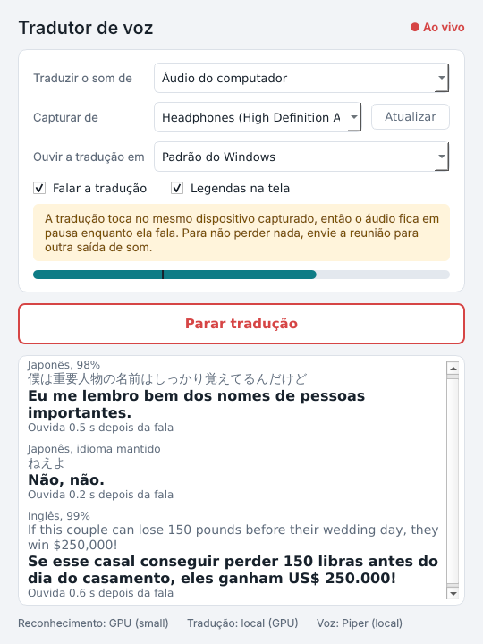
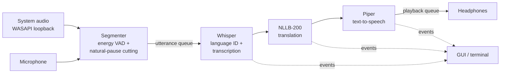

# 🌎 Real-Time Voice Translator

[](https://github.com/Ferpajr/realtime-voice-translator/actions/workflows/testes.yml)

**Hear any meeting or video translated into your language, in your headphones, in under a second — running 100% locally.**

A Windows desktop app that captures system audio (Zoom, Teams, Google Meet, YouTube…) or a microphone, detects the spoken language automatically, translates it, speaks the translation in your headphones and shows floating live subtitles. Speech recognition, translation and speech synthesis all run on your own machine: **the audio never leaves your computer**.

> 🇧🇷 *Resumo em português no final da página.*

<p align="center">
  
</p>
<p align="center">
  
  <br><em>Floating subtitles: always on top, drag to move, mouse wheel to resize.</em>
</p>

---

## ✨ Highlights

- **~0.2–0.6 s end-to-end latency** on a consumer NVIDIA GPU (measured, see below)
- **Automatic language detection** — ~100 input languages (Whisper), no need to pick the source language
- **System audio capture** via Windows WASAPI loopback — works with any meeting app or video, no virtual cables
- **Fully local pipeline** — no API keys, no cloud, no per-minute costs
- **Hardware-aware** — uses the GPU when an NVIDIA card is available, falls back to a lighter CPU profile otherwise
- **Desktop GUI** with live signal meter and floating subtitles, plus a terminal version
- **Crash-isolated** — the AI engine runs in its own process; if it ever fails, the window stays open and offers a restart
- **Tested** — 51 automated tests run on every push (GitHub Actions), no models or audio hardware needed

## 🏗️ Architecture



Capture, segmentation, processing and playback run in separate threads connected by queues, so listening never stops while a translation is playing. The `Pipeline` reports everything through events (`original`, `traducao`, `metricas`, `nivel`…), so the GUI and the terminal app are thin layers over the same core. Components are injected, which lets the whole flow be tested with fakes.

In the desktop app the engine runs in a **separate process** (`python -m tradutor_voz.processo`) and talks to the window through JSON lines over stdin/stdout. Qt and the AI libraries (CTranslate2, SentencePiece, ONNX Runtime) each ship their own Visual C++ runtime DLLs; in a single process they caused random access violations on Windows. Process isolation removed the crash entirely and means an engine failure can never take the window down.

```
tradutor_voz/
├── config.py        all settings (dataclass)
├── pipeline.py      threads, queues and events — the core
├── processo.py      runs the engine in its own process (JSON over stdin/stdout)
├── captura.py       device listing, microphone and loopback capture
├── segmentacao.py   speech segmentation (pure, testable)
├── transcricao.py   faster-whisper, GPU/CPU profile
├── traducao.py      NLLB-200 local + online fallbacks
├── voz.py           Piper / Edge TTS and playback
├── texto.py         text utilities: PT-PT→PT-BR, CJK splitting, hallucination filter
└── idiomas.py       language names and codes
app_gui.py           desktop app (PySide6)
app_terminal.py      terminal app
tests/               pytest suite
```

| Stage | Library | Notes |
|---|---|---|
| Capture | `soundcard` (WASAPI loopback), `sounddevice` | Choose which output to capture and where to play the translation |
| Segmentation | NumPy | Energy-based VAD; long speech is split at the quietest micro-pause, not mid-word |
| Speech-to-text | `faster-whisper` | GPU float16 or CPU int8; previous sentence passed as context |
| Translation | NLLB-200 600M via `ctranslate2` + `sentencepiece` | Sentence-level batching; Japanese/Chinese split on whitespace |
| Text-to-speech | `piper-tts` | ~0.1 s per sentence on CPU; speeds up automatically when a backlog builds |
| GUI | `PySide6` | Thread-safe event bridge via Qt signals |

## 📊 Measured latency

Time from the **end of a spoken sentence** to the **start of the translated audio** (Windows, NVIDIA GPU, Whisper `small`):

| Version | Speech-to-text | Translation | Voice | **Total** |
|---|---|---|---|---|
| First prototype — CPU + online services | ~2 s | 0.4–4 s | 1–2 s | **~3–4 s** |
| Current — fully local, GPU | 0.1–0.4 s | 0.0–0.1 s | 0.0–0.1 s | **~0.2–0.6 s** |

## 🧠 Engineering problems solved

- **Echo loop** — when capture and playback share a device, the translator would hear its own voice. Capture is gated while translated speech plays, and the GUI warns when the devices match; routing them to different outputs removes the trade-off.
- **Whisper hallucinations** — on music or silence Whisper invents phrases like *"Thanks for watching!"*. A phrase filter plus a language-confidence threshold drops them.
- **Short utterances** — one-word interjections get low language confidence. When in doubt, the transcriber re-decodes using the language of the ongoing conversation.
- **Context loss in long speech** — instead of a hard cut at N seconds, the segmenter cuts at the quietest point in the last 3 s and carries the remainder forward.
- **Clicks and pops** — a short noise followed by silence used to become an "utterance"; segments now require a minimum amount of actual speech (caught by the test suite).
- **Backlog** — continuous speech can outpace playback; speech rate increases automatically when translations queue up.
- **Native crashes between Qt and the AI stack** — `faulthandler` traced an access violation to Qt rendering text while SentencePiece encoded in another thread; moving the engine to its own process fixed it, and the GUI now detects an engine crash and offers a restart.
- **Windows quirks** — loopback delivers no frames during silence; COM is initialized per capture thread so it coexists with Qt; eSpeak fails on non-ASCII paths (data copied to an ASCII-only folder and validated in a subprocess so a native crash can't take down the app); CUDA DLLs are loaded from pip-installed NVIDIA wheels, no CUDA toolkit needed.
- **European vs. Brazilian Portuguese** — NLLB outputs mostly European Portuguese; a rule-based post-processor converts common constructions (*"lembro-me" → "me lembro"*, *"está a fazer" → "está fazendo"*, *"telemóvel" → "celular"*).

## 🚀 Getting started

**Requirements:** Windows 10/11, Python 3.11 or 3.12. An NVIDIA GPU is optional but recommended.

```powershell
git clone https://github.com/Ferpajr/realtime-voice-translator.git
cd realtime-voice-translator
python -m venv venv
Set-ExecutionPolicy -Scope Process -ExecutionPolicy Bypass
.\venv\Scripts\Activate.ps1
pip install -r requirements.txt

# Optional, NVIDIA GPU only (~1 GB, no CUDA toolkit needed):
pip install -r requirements-gpu.txt

python app_gui.py          # desktop app
python app_terminal.py     # terminal version (see --help)
```

On first run the app downloads the models automatically (Whisper, the NLLB translator ~1.2 GB and the Piper voice ~60 MB).

### Recommended setup for meetings

1. In Windows **Settings → System → Sound → Volume mixer**, send your meeting app or browser to a secondary output (e.g. your monitor's speakers).
2. In the app, capture that secondary output and play the translation on your **headphones**.

This avoids the echo gate entirely, so nothing is lost while the translation is speaking.

### Configuration

All settings live in [`tradutor_voz/config.py`](tradutor_voz/config.py). The most useful ones:

| Setting | Default | Description |
|---|---|---|
| `idioma_destino` | `"pt"` | Target language |
| `usar_gpu` | `True` | `False` simulates a machine without NVIDIA (`--sem-gpu` in the terminal) |
| `modelo_whisper_gpu` / `modelo_whisper_cpu` | `small` / `base` | Try `large-v3-turbo` on GPU for higher accuracy |
| `motor_traducao` | `"local"` | `"internet"` to use online translation instead |
| `motor_voz` | `"piper"` | `"edge"` for a more natural online voice |
| `falar_traducao` | `True` | `False` for subtitles only (also a checkbox in the GUI) |

## 🧪 Tests

```powershell
pip install -r requirements-dev.txt
pytest -v
```

The suite covers text processing, speech segmentation and the full pipeline (capture → transcription → translation → voice) using fake components, so it runs anywhere in a few seconds — including CI.

## 🗺️ Roadmap

- [x] Desktop GUI with floating live subtitles
- [x] Automated tests and CI
- [ ] Windows installer (PyInstaller + Inno Setup)
- [ ] Commercially licensed model stack (MADLAD-400 / Opus-MT for translation, Kokoro for TTS)
- [ ] AMD/Intel GPU support (whisper.cpp + Vulkan)
- [ ] Optional cloud mode for low-end machines
- [ ] Two-way mode: translate your own microphone into the meeting

## ⚖️ Licenses

This project's source code is released under the [MIT License](LICENSE). It relies on third-party models and libraries with their own terms — **some of them are non-commercial**:

| Component | License |
|---|---|
| Whisper / faster-whisper, CTranslate2 | MIT |
| PySide6 | LGPL-3.0 |
| **NLLB-200** (translation model) | **CC-BY-NC 4.0 — non-commercial use only** |
| **piper-tts** | **GPL-3.0**; each voice has its own license |
| Online fallbacks (Google Translate web endpoint, Edge TTS) | Unofficial endpoints, for personal/educational use |

This repository is a portfolio and educational prototype. A commercial product would need the components marked above replaced with commercially licensed alternatives.

---

## 🇧🇷 Resumo em português

Aplicativo para Windows de **tradução de voz em tempo real**: captura o áudio do PC (reuniões no Zoom, Teams, Meet ou vídeos) ou do microfone, detecta o idioma automaticamente, traduz, fala a tradução no fone e mostra **legendas flutuantes**, em **cerca de 0,2 a 0,6 segundo**. Tudo roda **localmente** (Whisper + NLLB + Piper), sem chave de API e sem enviar o áudio para a nuvem. Funciona com placa NVIDIA (mais rápido) ou só com o processador.

```powershell
python app_gui.py        # aplicativo com janela e legendas
python app_terminal.py   # versão de terminal
```

---

Built by [Fernando](https://github.com/Ferpajr) — AI engineering portfolio project.
